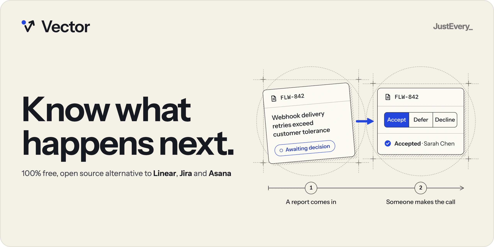
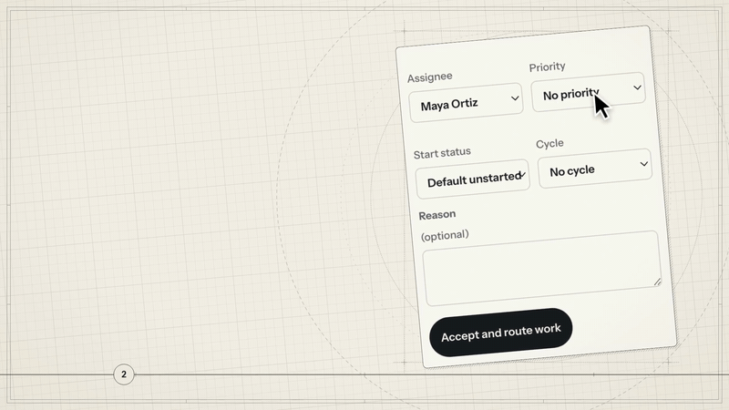
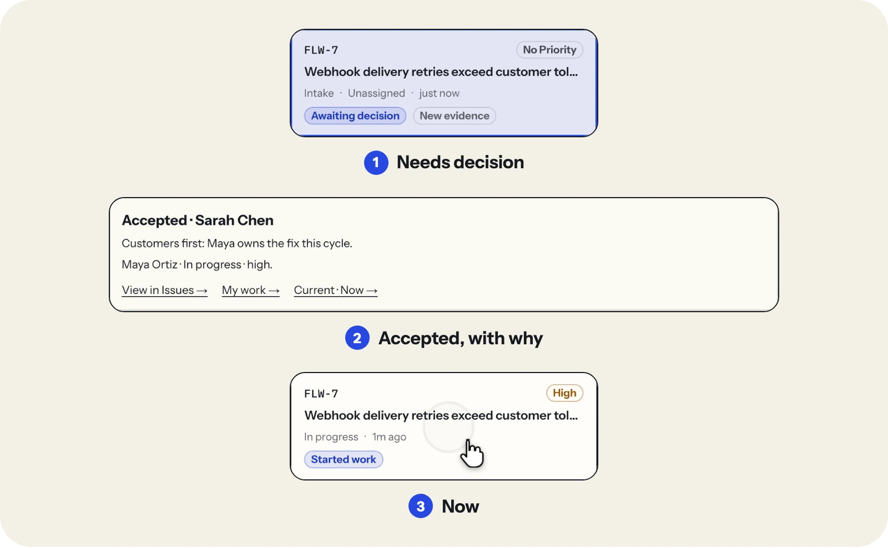
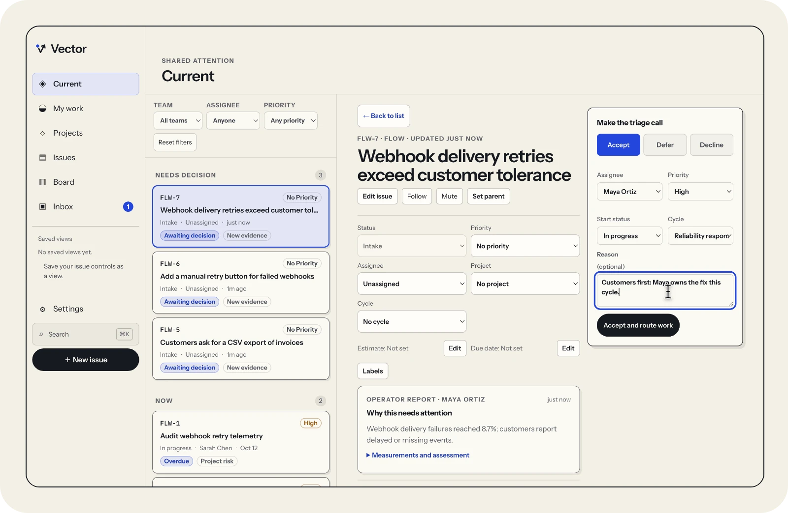
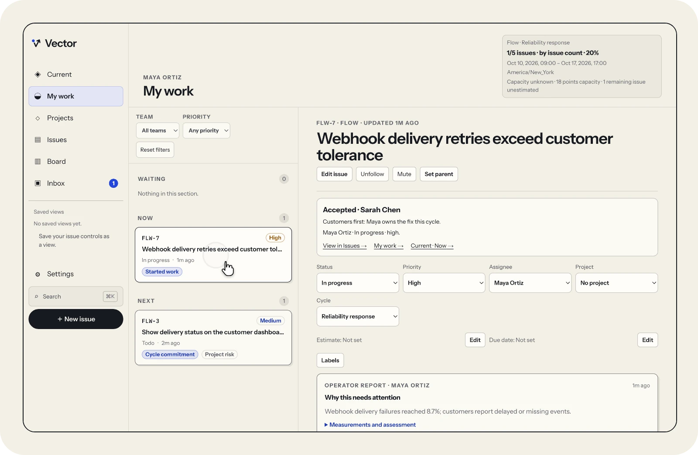

<p align="center">
  <a href="https://run-vector.com">
    <picture>
      <source media="(prefers-color-scheme: dark)" srcset=".github/assets/banner-dark.webp">
      <source media="(prefers-color-scheme: light)" srcset=".github/assets/banner-light.webp">
      
    </picture>
  </a>
</p>

<p align="center"><a href="https://run-vector.com">run-vector.com</a> · <a href="https://justevery.com">Part of Just Every</a> · <a href="LICENSE">MIT licensed</a></p>

<p align="center">
  <a href="https://justevery.com/#vol-vector"></a>
</p>
<p align="center"><a href="https://justevery.com/#vol-vector"><b>Watch the full demo</b></a> · 55 seconds</p>

<p align="center">
  
</p>

<p align="center">
  <br>
  <sub>Every report gets a triage call: accept, defer or decline, with a reason.</sub>
</p>

<p align="center">
  <br>
  <sub>The decision and its reason travel with the issue.</sub>
</p>

# Vector

Vector is a deployable, self-hosted issue tracker for one business. Evidence-led intake supports explicit accept, defer and decline decisions. Current explains what needs attention; My work, projects, dependencies and a personal Inbox organize execution. Issues include inline editing for labels, estimate, due date, expected outcome and customer impact, plus comments, safe Markdown, named links, private files and an immutable activity history. Each inline property change uses the existing version-checked issue PATCH; title and description remain in the writing editor. That editor retains the newest successful save or validated reload receipt for the same issue, so reopening before a background refresh uses its current version while genuine conflicts keep unsaved drafts.

The application runs on a Cloudflare Worker with TanStack Start, React and Hono, D1 for records and R2 for files. Operators sign in by email; Settings provides invitations, removal, workspace timezone and daily reminder controls and administration for teams, workflows, labels, projects and cycles. The source is MIT licensed at [just-every/run-vector](https://github.com/just-every/run-vector).

## Run it on your computer

You need Git and Node 22 or later, on macOS, Linux or Windows with WSL2. One line, the same as on [run-vector.com/run](https://run-vector.com/run), installs rer (the Run Edit Run command), clones Vector and starts it:

<!-- vector-start -->
```sh
npx -y @runeditrun/rer dev just-every/run-vector
```

To start it again later, run `cd run-vector && rer dev`. The line installs the current global rer launcher; inside this checkout, rer runs the exact dependency declared in `package.json`. The global launcher and the checkout’s CLI can therefore have different versions.

Vector has its own release numbers: [the latest tagged Vector release is v0.2.0](https://github.com/just-every/run-vector/tree/v0.2.0). The clone follows `main`, which includes changes since v0.2.0. To use that tagged release instead, run `git checkout v0.2.0` in the checkout before `rer dev`; rer then uses the CLI pin recorded by that release.

The first `rer dev` installs the pinned Node, pnpm and dependencies, makes you the local owner and prints a link that opens Vector signed in. There is nothing else to install and no provider account to set up.

On a fresh checkout, `rer dev` prepares a local placeholder owner (`owner@run-vector.test`). To choose your own local owner instead, run this optional setup **before the first `rer dev`**, replacing the example mailbox. Choose another explicit port if 8787 is occupied.

<!-- vector-setup -->
```sh
rer setup --owner-email owner@example.test --port "${VECTOR_PORT:-8787}" --non-interactive
```

Setup builds and applies migrations, saves owner-only `.dev.vars`, prepares your first owner and stops its temporary app. A second setup preserves the owner, data and settings. Once development has initialized the placeholder owner, setup cannot silently replace it with another mailbox. Keep that owner and existing data, or, for a disposable installation, stop development, retain any needed export, explicitly run `rer reset --yes`, then run setup with your chosen mailbox and start development again. Reset deletes the local installation. Supply a private JSON `--answers` file for workspace, timezone and team values declared in `rer-setup.json`; otherwise its defaults apply. Existing installations must follow [local recovery](docs/LOCAL-RECOVERY.md) before changing their state path.

Development prints `RER_READY` only after health is ready, then `RER_SIGNED_IN` (the owner) and `RER_OPEN`. Open `RER_OPEN` in a browser on this computer to enter as the owner; finish your first workspace review at `/setup`. The link carries this checkout's private dev key in its fragment: treat it as a credential and never share it. Reset removes the key and invalidates earlier dev browser sessions. Local titles and the app name carry a Dev suffix. Development has no toolbar or captured-mail UI. To try a second operator, first open the owner’s link, then run `rer dev --as teammate` and open its `RER_OPEN` link in the **same browser**. Creating the teammate needs that owner session; a fresh browser can return `unauthenticated` until the teammate has been created. This switches to a separate local operator, not an invitation’s email address. Local invitations send no email; deploy Vector to invite someone by email. Use `--as signed-out` for no session; Vector has no product roles. The legacy `--login` flag uses the same automatic owner entry. `rer preview` serves production output and prints its ready address without a captured-mail sign-in flow. `RER_OPEN` is for people at this terminal; scripts can use `rer dev --json` and the key header. Stop the background development server with `rer dev --stop`. Data is stored in `.wrangler/state` and private settings are excluded from builds.

`rer verify` runs the build, artifact and contract checks. The browser test suites are for contributors and run in CI; see [Verification](docs/VERIFICATION.md).

Review the inventory before removing local data. Stop the app, retain an export and your backups, then explicitly confirm:

```sh
rer reset --yes
```

Reset removes local D1/R2, owner/sessions/outbox, installer drafts and generated settings. Source, dependencies, export archives and `.rer/deploy` receipts survive. See [SEED-COMMAND-CONTRACT.md](SEED-COMMAND-CONTRACT.md) for flags, exit codes and private state custody, and [Installer instructions](docs/INSTALLER.md) for setup details.

## Managed hosting

Managed Vector uses the Run Edit Run mail relay for sign-in, invitations, assignments and direct mentions. Configure supplies and hides `MAIL_PROVIDER=rer`, `MAIL_FROM`, `MAIL_RELAY_URL` and the private `MAIL_API_KEY`; you do not need a mail-provider account or key. Free and Assisted provider choices remain available. See [Managed source](docs/MANAGED-SOURCE.md) for relay limits and credential recovery. Hosted delivery acceptance requires separate validation.

## Your own hosting account

Commit your checkout before deploying; `rer deploy` builds it. Then supply your explicit `CLOUDFLARE_ACCOUNT_ID`, `CLOUDFLARE_API_TOKEN`, verified sender `MAIL_FROM` (a mailbox or `Name <address>`), `SENDGRID_API_KEY`, and set `OWNER_EMAIL` to the mailbox that will own the hosted installation. Also supply the public `FIRST_OWNER_NAME`, `WORKSPACE_NAME`, `WORKSPACE_TIMEZONE`, `DEFAULT_TEAM_NAME` and `DEFAULT_TEAM_PREFIX` values. Follow [DEPLOY.md](DEPLOY.md) for private secret/state custody, the resulting workers.dev origin and permissions.

```sh
FIRST_OWNER_EMAIL="$OWNER_EMAIL" rer deploy
```

Without `--environment NAME` this deploys the `production` environment, and every later `rer deploy`, `rer signin` and `rer deploy --remove --yes` from this checkout acts on `production` too. If you deploy a named environment instead, pass the same `--environment NAME` to each of those commands.

Vector’s current deployment adapter reads the internal `FIRST_OWNER_EMAIL` binding; the explicit assignment maps your `OWNER_EMAIL` into that adapter. Local `rer setup` does not choose or replace the hosted owner. The hosted owner is selected from this deployment input.

This uses the published package’s owner-account deploy and health checks with the same durable declaration and `.rer/deploy` state. `SENDGRID_API_KEY` maps to the established Worker binding `MAIL_API_KEY`. They do not use ambient Wrangler login. When it finishes, `rer deploy` prints the address of your installation. Open it and sign in by email as `OWNER_EMAIL`: that first sign-in makes you the owner automatically, so there is no setup token or claim step to run. The separate reviewed artifact controller is described in [DEPLOY.md](DEPLOY.md).

Production deployment requires configured outbound email or an approved Auth SSO setup dependency. Vector’s documented deployment path uses SendGrid. `rer signin` remains owner recovery when sign-in email does not arrive; run it with the same Cloudflare credentials that deployed the installation, from the deploying checkout:

```sh
rer signin
```

It prints a one-time sign-in link for the hosted owner. The link works once, only for that owner, expires in 15 minutes and is never saved; open it in your browser and press **Confirm**.

Estimated infrastructure cost is **USD 0–15/month**, assuming up to 20 operators, 100,000 issues, 5 GB attachments and moderate traffic. Transactional email is billed separately. These are estimates, not a capacity qualification or a claim of hosted commissioning. Local provider fixtures prove behavior without making a real deployment.

## Update an installation

### From v0.1.0

For local sample data, stop the old runtime and follow [local recovery](docs/LOCAL-RECOVERY.md) before setup: back up and move `.wrangler/vector-dev` to `.wrangler/state`, retaining the existing owner (`sarah@vector.test` for the original samples). The guide also covers correcting private settings left by an earlier failed upgrade. Do not reset retained data.

For hosted v0.1.0 installations made with `pnpm run deploy`, follow [the hosted upgrade guide](docs/HOSTED-UPGRADE.md). That command now invokes `rer deploy`, which targets a different owner-account installation. Update the original reviewed controller plan and resources with `pnpm artifact:deploy` and a new artifact/run/receipt. Migration 0046 deletes pending identity-dependency approvals, which owners must renew.

### Installations created with rer deploy

Stop local development and keep matching source, D1/R2 backups and the private `.rer/deploy` directory. With the published `rer` command installed, update the source and deploy:

```sh
git pull --ff-only
rer deploy
```

No separate Node or pnpm installation is required: `rer` installs the package pin and dependencies a pull changed before it deploys. Deployment preserves applied migration history and private secrets; it refuses changed or uncertain history. See [archives](docs/ARCHIVES.md) before restoring a backup.

## Remove an installation

To take the installation down, run this from the checkout that deployed it, with the same Cloudflare credentials:

```sh
rer deploy --remove --yes
```

It deletes the Worker, D1 database and R2 bucket that this checkout's `.rer/deploy` record says `rer` created, with their data, confirms each is gone and touches nothing else. Export first if you want to keep anything. It removes the `production` environment; for a named environment add the same `--environment NAME` you deployed with.

The same command empties the owned R2 bucket, including attached files, before deleting it. No separate dashboard or Wrangler cleanup is required. Uncertain resource ownership or incomplete pagination proof still stops removal.

## Workspace administration

After signing in, use Settings' section links to reach workspace time, operators, teams, labels, projects, cycles and notifications. Create projects from the Projects page: the portfolio stays visible until you open the New project form, and project lead, lifecycle and archive controls are on the project detail page. Administration rows show a disclosure arrow and focus/hover treatment. Each team starts with Intake, Backlog, Unstarted, Started, Completed, Canceled and Duplicate categories. You can add, rename and reorder statuses; the first status in each category is its default, and each category must keep one status. Removing a status requires a same-category replacement and remaps its issues. A team’s identifier prefix can be changed only before issue history exists for that team. Archiving a team preserves its issues, cycles, projects, identifiers and history and prevents new issues, operator intake and issue moves from targeting it; unarchiving restores use.

Labels can be renamed, recoloured and deleted. Deleting a label also removes it from issue selections and saved-view filters. Issue label changes enforce the current configured per-issue limit. Projects start as Planned, have a safe Markdown description, an active operator lead and an optional target date; operators set lifecycle manually to Planned, Active, Completed or Canceled. Archiving hides a project from the default portfolio and preserves its issues; use Include archived on the Projects page to find it. Cycle times use the workspace timezone, and cycles for one team cannot overlap. Nonexistent or ambiguous daylight-saving times are rejected. Operators create cycles manually, with optional capacity, and can commit, move or uncommit issues from issue details or the cycle page. Cycle dates and capacity cannot be edited after creation. Ended cycles close automatically: Unstarted and Started work rolls into the next cycle and other statuses uncommit. If no next cycle exists, unfinished work uncommits with a visible failure on the closed cycle. Cycle detail and project history retain frozen estimates, capacity, progress and identifiers through later issue edits or deletion; closed cycles cannot reopen. Hosted Cron timing requires deployment acceptance.

On mobile, the account menu keeps the signed-in name, Settings and Sign out available. Sign out pauses coordinated private API reads and drains responses already in progress before revoking the session; if that wait fails, it reports the error and resumes reads so you can retry. Server session and ownership checks still govern every private request.

## Issue browsing, boards and search

Use Issues for a paged list of work. Filter by status or category, priority, assignee, team, project, cycle, label, due date, blocked state, and parent; the parent filter can show roots or children of one issue. Issue details let you set, change or clear a parent and show its children; self-links and ancestry cycles are refused. Sort by creation time, priority, workflow order, due date or last update, and group by status, assignee, priority, project, cycle or team. Grouped pages put each group before the selected sort and stable identifier; only groups with rows on the page appear, carrying counts for the full filtered result. A large group can continue onto another page. Ordinary list pages default to 50. Completed issues stay out of the default issue list. Select up to 250 rows for an atomic bulk edit of status, assignee, priority, project, cycle or labels; a failed item leaves the whole batch unchanged and names the issues that need attention.

The Board shows one team's workflow at a time. Choose the team explicitly, then read its configured statuses in workflow order. Board URLs and API requests explicitly use `pageSize=100` and `grouping=status` so each workflow column keeps the selected sort; only 50 or 100 is accepted. Cards follow the board filters, selected sort and current page, while each column’s count comes from SQL across the complete matching result and “Showing … of …” distinguishes the current page. Use paging to reach remaining cards; completed issues remain hidden until requested. The labelled status selector on each card works with the keyboard and uses the normal version-checked issue update. Intake and duplicate decisions still use their issue decision controls, and a stale update reports the current server values. On a 390 px phone layout, use the labelled Board column selector to choose a status column.

Save an issue query with its filters, sort, grouping and either list or board layout as a private or shared view. Owners can rename, edit, duplicate and delete their views. Board layout displays status grouping and a 100-row request without changing a saved view’s stored query until its owner saves the controls. A successful rename updates the page title and navigation immediately from its mutation receipt; delayed older reads cannot roll it back, and subsequent server access denial still clears it. Any operator can open or duplicate a shared view; only its owner can edit or delete it. Personal control preferences for Issues, Board, Current, My work and Projects restore across browsers and can be reset from the visible control. Opening a saved view does not replace those personal controls. On a phone, the Issues, Board and saved-view pages open a Board and saved views menu above the list.

Search from the Search page or the command palette. It finds issue identifiers and searchable issue text (titles, descriptions, expected outcomes, customer impact, comments and evidence summaries), as well as project names, label names and saved-view names you can access. The Search page's Include archived teams and projects control expands results; the command palette uses the default non-archived set. An exact issue identifier uses the issue record directly and ranks first, with other matching issues, projects and accessible saved views following within bounded results. The palette opens accessible saved views directly. FTS results join stable source TEXT IDs, so storage rowid changes and index rebuilds do not change record identity. Full-text entries are updated by database triggers in the same transaction as searchable changes; if an index query fails, an exact identifier can still return the primary lookup under the archive policy and freshly checked session/operator/workspace admission. Other failed index reads report Search unavailable rather than an empty result.

Press Command/Ctrl-K to open the palette, use C for a new issue, and use G then M, G then C or G then P for My work, Current or Projects. Escape closes the topmost transient surface. Visible links and controls remain available for each command.

## Collaboration and notifications

Operators can follow or mute their own issue notifications. Creators, assignees, commenters and selected mention recipients follow automatically. The issue description and comment editors offer autocomplete for active workspace operators; suggestions show names without internal IDs, and recognized mentions render as chips while unknown or removed IDs remain literal text. Comments show relative times and label their own link control. Inbox rows use relative times and keep issue identifiers together on mobile; the empty state explains that assignments and mentions appear there. Editing a body notifies only newly mentioned operators. Follow, mute, read and notification-preference changes do not change the issue version.

Inbox lists assignments, selected mentions, comments on followed issues, returns of an operator's deferred intake, last-blocker resolution from a status change or dependency removal, and daily due/first-overdue reminders for assigned incomplete work. Settings sets the workspace reminder clock (09:00 by default). Opening a row marks it read; Mark all read and a live unread count are available. Settings controls event-type mutes, email preference and issue mutes, and shows failed or uncertain email outcomes. Mutes suppress future matching Inbox events and any matching mail that has not yet been sent; email opt-out also suppresses unsent mail while leaving Inbox active. Mutes do not unfollow issues or change historical Inbox rows or activity; unmuting does not backfill notifications.

Email is limited to assignments and direct mentions. It uses the pinned Base transactional mail adapter: the RER relay for Managed hosting, or the configured provider such as SendGrid for owner-account hosting. `NOTIFICATION_EMAIL_ENABLED=false` or unavailable mail capability disables it without queuing mail intents; each operator's preference defaults on when email is available. When email or operator removal is unavailable because deployment setup is incomplete, Settings explains who can finish setup and points to DEPLOY.md. A message contains the recipient address, issue title and identifier, readable actor, and a canonical issue link that requires sign-in. It includes no issue body, evidence or attachment details. Accepted messages are not proof of mailbox arrival; a definite provider rejection or rate limit gets at most three total attempts within 24 hours, with retries run by Cron and delayed by any provider `Retry-After`, while uncertain or interrupted sends are never automatically resent. An already-started external send cannot be recalled by later local erasure. Due reminders stay in the Inbox. Digests, Slack and other chat channels remain deferred. See [Notifications and outbound email](docs/NOTIFICATIONS.md) for configuration, retry and privacy details.

## Data and updates

Local installation archives use the public `rer export --output FILE` and `rer import --input FILE --yes` commands. Stop development first. Import requires an empty product database and FILES bucket; export creates a new owner-only file. Save archives under the unserved `exports/` folder, such as `exports/vector.jsonl`, or at an absolute path outside the checkout; copy a private archive into a different checkout before restoring there. See [Data ownership](docs/DATA-OWNERSHIP.md) for contents, credential exclusions, fresh owner sign-in, historical delivery quarantine and restore review. FTS is derived and rebuilt from stable primary IDs. Authenticated HTTP export and restore use the same Base engine with Vector's atomic pristine-bootstrap admission and a Durable Object coordinator. Restore requires a fresh ordinary owner sign-in before setup or edits; after commit, sign in freshly as the historical owner. Local Worker HTTP proof does not establish hosted HTTPS acceptance. See [Archives](docs/ARCHIVES.md).

Settings supports reviewed mapped CSV/JSON and Linear imports (documented CSV format and owner-made API file, tested at 2,000 issues with a generator; no owner export supplied), scoped API tokens, signed source receivers and GitHub PR webhook links. See [Move in](docs/MOVE-IN.md), [API](docs/API.md) and [Integrations](docs/INTEGRATIONS.md). Outbound delivery stays unconfigured until the owner provides an enforcing transport. No replacement-product claim is added. Preserve provider backups, private settings and compatible source before upgrades. Apply new migrations forward, keep additive schema and durable histories on code rollback, and validate recovery in isolated resources. Source before migration 0018 cannot read the current stable-ID search schema.

Browser verification covers the core product journey and a representative accessibility and overflow pass. Release visual review covers the remaining layouts.

Contributors changing recorded Base copies follow [AGENTS.md](AGENTS.md). See [HANDOVER.md](HANDOVER.md) for implemented scope and limitations, [CHANGELOG.md](CHANGELOG.md) for release changes, and [CONTRACT.md](CONTRACT.md) / [BASELINE.md](BASELINE.md) for requirements. Passing local checks does not establish every wider product, capacity or hosted-delivery guarantee.

The Base runtime selections and schema validator are pinned together; see [Base adoption](docs/BASE-ADOPTION.md) for exact copy custody, additive migrations and recovery.


Wave B source preparation: see [managed source and recovery](docs/MANAGED-SOURCE.md). The generated private-source descriptor/workflow, Base delivery producer, signed native owner claim and owner-gated editor are source adoption; hosted installation/service acceptance, live accounts and public publishing remain owner work. Apply 0024 additively and retain permanent admission ledgers. Native/browser verification status is recorded in the current task evidence, not inferred from packaging.
